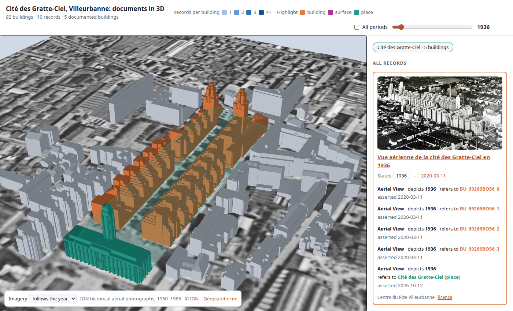

# UD-AGAPE-Demo-AN_UseCase
Demo for Archives Nationales use case in the AGAPE project

*The [3D viewer](data/viewer/README.md): the 1936 aerial view of the Cité des Gratte-Ciel highlights the four blocks it refers to (orange) and, through its reference to the district, the rest of the place and its outline (green).*

## Alignment of ontologies
* [CityGML 3.0, especially CityRDF (formerly CityOWL)](https://dataset-dl.liris.cnrs.fr/rdf-owl-urban-data-ontologies/Ontologies/CityOWL/)
* [International Council on Archives Records in Contexts Ontology (ICA RiC-O) version 1.1](https://www.ica.org/standards/RiC/RiC-O_1-1.html)
