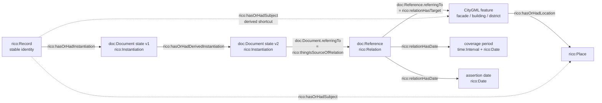

# Alignment with archival and provenance ontologies

This folder aligns the urban documentation data ([`../gratteciel/`](../gratteciel/)), modelled with CityGML 3.0 (CityRDF, published as CityOWL) and its Document ontology, with:

* [RiC-O 1.1](https://www.ica.org/standards/RiC/RiC-O_1-1.html), the International Council on Archives ontology for archival description, which is the main target;
* [PROV-O](https://www.w3.org/TR/prov-o/), for the provenance of document states and of references, where RiC-O is not the right tool;
* [DCMI Metadata Terms](https://www.dublincore.org/specifications/dublin-core/dcmi-terms/) and [GeoSPARQL](https://www.ogc.org/standard/geosparql/), for generic metadata and spatial querying.

The Document ontology is the one presented in *From Versioned Cities to Versioned Documents: Extending CityRDF for Modelling Urban Documentation over Time* (3DGeoInfo 2026). The alignment is designed against the article's goals, its requirements R1–R5. The article states that the Document model "does not replace" archival vocabularies: document metadata and archival context can come from them, while `doc:Reference` keeps the temporally qualified relation between a document state and an urban feature. The alignment follows that division of roles. It is purely additive: no CityGML or Document-ontology triple is changed or removed.

After alignment, an archive can ask *"which records are about this place, depicting which period, asserted when?"*, while the city model keeps its own feature versions and geometry.

## How the alignment serves the Document-model goals

| Goal (and model construct) | Alignment | Why |
|---|---|---|
| **R1** `doc:Document ⊑ core:AbstractFeatureWithLifespan`: documents are principal urban features | Only `doc:Document ⊑ prov:Entity` is added (already implied by the data's use of `prov:wasRevisionOf`); RiC types are added by rules | `doc:Document` keeps the definition and role the article gives it |
| **R2** heterogeneous documents, `doc:Tag`, `doc:PurposeTypeValue` (⊑ `skos:Concept`) | Tags → `rico:Concept` subjects of the record; purpose types → `rico:Type` of the reference | Tags are the first indexing layer for retrieval; purpose qualifies the *reference*, so it stays on the reference |
| **R3** document versions with a stable identity | Stable identity → `rico:Record`; each `doc:Document` state → `rico:Instantiation`; `prov:wasRevisionOf` → `rico:hasOrHadDerivedInstantiation`, plus a `prov:Activity` per revision | RiC's Record / Instantiation split is the archival form of "stable identity + successive states"; PROV records the digitisation, restoration or annotation that produced each state |
| **R3–R4** `doc:Reference` separates file identity from interpretation | `doc:Reference ⊑ rico:Relation` (RiC-O's n-ary relation): source = document state, target = urban feature, `referenceText` → `rico:generalDescription` | The reference is kept as an object. It is not collapsed into a direct link. |
| **R4** dual timeline: `coveragePeriod` (depiction) vs `referringDate` (assertion) vs city-object lifespan | Both reference dates → `rico:relationHasDate`, distinguished by `rico:DateType`; also `referringDate` → `prov:generatedAtTime` and `coveragePeriod` → `dct:temporal`; the city-object lifespan is not mapped | The three temporalities stay separate, and each is expressed in the vocabulary built for it |
| **R5** multi-scale targets: any `core:AbstractFeatureWithLifespan` | The relation target is whatever feature the reference points to (facade, building part, building, district) | No restriction to `bldg:Building` |



## Beyond RiC-O: PROV-O, Dublin Core, GeoSPARQL

| Need | Why RiC-O alone is not enough | Vocabulary used |
|---|---|---|
| Provenance of each **reference**: when it was asserted, by whom or by what (curator, annotation tool, language model), by which activity | A `rico:Relation` has dates and a certainty, but no notion of a statement generated by an activity or attributed to a software agent. Auditable links are a stated goal of the Document model, especially for machine-suggested links. | PROV-O: `doc:Reference ⊑ prov:Entity`, `referringDate ⊑ prov:generatedAtTime`, `prov:wasAttributedTo`, `prov:wasGeneratedBy` |
| The **activity** behind each document state (digitisation, restoration, annotation) | RiC-O has derivation links between instantiations, but the data already uses PROV for the version chain | PROV-O: one `prov:Activity` per revision that `prov:used` the older state and generated the newer one |
| **Depicted period** as generic coverage metadata | Exists in RiC only as a typed date on the relation | `dct:temporal` |
| **Spatial queries** on places | RiC-O coordinates are plain literals | GeoSPARQL `geo:hasGeometry` / `geo:asWKT` on `rico:Place` |

The PROV-O and Dublin Core mappings are sub-class and sub-property axioms only. The only relevant disjointness, PROV's `prov:Entity` vs `prov:Activity`, is respected. They are compatible with the alignments published with the ontologies, [`CityGML3-DCMI`](https://dataset-dl.liris.cnrs.fr/rdf-owl-urban-data-ontologies/Ontologies/Alignments/CityGML3-DCMI.ttl) and [`CityGML3-GeoSPARQL`](https://dataset-dl.liris.cnrs.fr/rdf-owl-urban-data-ontologies/Ontologies/Alignments/CityGML3-GeoSPARQL.ttl), and use different Dublin Core terms.

### Recording who asserted a reference

The data doesn't record agents yet. Standard PROV-O can record them, for example a curator, and a reference suggested by a language model and validated by that curator:

```turtle
data:curator_1 a prov:Person .
data:llm_linker a prov:SoftwareAgent ; rdfs:label "Candidate-link generator" .

data:reference_3 prov:wasAttributedTo data:curator_1 ;
    prov:wasGeneratedBy [ a prov:Activity ;
        prov:wasAssociatedWith data:llm_linker , data:curator_1 ] ;
    rico:relationCertainty "quite probable" .
```

[`queries/provenance.rq`](queries/provenance.rq) returns `prov:wasAttributedTo` when present.

## Places

RiC-O describes *where* with `rico:Place`: a persistent, named area, with its location (`rico:PhysicalLocation`, `rico:Coordinates`) modelled separately. CityGML features are **linked** to places with `rico:hasOrHadLocation`, never declared equivalent:

* **Several features or versions can share one place.** When the city model is re-segmented or re-versioned, the new features point to the same place.
* **Buildings and components stay CityGML features** and remain the reference targets. Only named areas (commune, district) become places.
* **Geometry stays in CityGML.** RiC-O coordinates are a point. The district also gets the same point as a GeoSPARQL geometry.

[`gratteciel-places.ttl`](gratteciel-places.ttl) defines Villeurbanne (INSEE 69266) → Cité des Gratte-Ciel. The district coordinates (45.76816, 4.87959) are the WGS84 centroid of the four buildings' LoD2 roof vertices, reprojected from EPSG:3946.

## Files

| File | Content |
|---|---|
| [`citygml3-rico.ttl`](citygml3-rico.ttl) | RiC-O alignment: `doc:Reference ⊑ rico:Relation`, its properties as sub-properties of RiC relation properties, `doc:PurposeTypeValue ⊑ rico:Type`, the two `rico:DateType`s, and SKOS correspondences for the class-level mapping |
| [`citygml3-prov.ttl`](citygml3-prov.ttl) | PROV-O alignment: document states and references as `prov:Entity`, assertion date as `prov:generatedAtTime` |
| [`citygml3-dcterms.ttl`](citygml3-dcterms.ttl) | Dublin Core alignment: coverage period, title, tags, media URI |
| [`citygml3-cwa-owa.ttl`](citygml3-cwa-owa.ttl) | Bridge from the CityOWL CWA terms used by the data to CityOWL OWA, for working with the open-world network (see *CWA and OWA*) |
| [`gratteciel-places.ttl`](gratteciel-places.ttl) | Place authority and the links from CityGML features to it. The only hand-curated, dataset-specific file. |
| [`rules/`](rules/) | SPARQL Update rules, run in file-name order |
| [`queries/`](queries/) | Example SPARQL queries over the aligned graph |
| [`materialize.py`](materialize.py) | Applies the alignment with rdflib and writes the aligned graph |
| [`validate.py`](validate.py) | Checks the aligned data against the CWA or OWA network, RiC-O and PROV-O in [`../../ontologies/`](../../ontologies/) |

| Rule | Creates |
|---|---|
| [`01-records-and-instantiations.ru`](rules/01-records-and-instantiations.ru) | One `rico:Instantiation` per `doc:Document` state and one `rico:Record` per version chain, named after its oldest state so the IRI stays stable (`data:document_1_original` → `data:document_1_original_record`) and titled after its newest state |
| [`02-references-as-relations.ru`](rules/02-references-as-relations.ru) | Each `doc:Reference` as a `rico:Relation` with source, target, description, purpose type, and both dates |
| [`03-subjects-and-places.ru`](rules/03-subjects-and-places.ru) | Record-level `rico:hasOrHadSubject` shortcuts to features and places; parts and surfaces inherit their building's place |
| [`04-tags.ru`](rules/04-tags.ru) | `doc:Tag`s as `rico:Concept` subjects of the record |
| [`05-provenance-and-metadata.ru`](rules/05-provenance-and-metadata.ru) | PROV-O and Dublin Core triples for documents and references, and one `prov:Activity` per revision (`<newer state>_generation`) |

`02` and `05` add the same triples a reasoner would derive from the alignment files, so triple stores without inference get the full RiC view. The rules only insert triples, so running them again is harmless.

The record-level `rico:hasOrHadSubject` links in `03` are RiC's direct shortcut for the relation. They are convenient for archival queries but lossy: they don't record which state, period, assertion date or purpose a link came from. The qualified link remains the `doc:Reference` / `rico:Relation`.

### Mappings deliberately left out

* **City-object lifespan** (`core:AbstractFeatureWithLifespan.creationDate` on buildings) stays on the CityGML side. Mapping it to `rico:creationDate` would also, through the RiC-O domain, wrongly classify every building as a `rico:Instantiation`.
* **Plain-literal tags and purpose types** are skipped: the Document ontology requires `doc:Tag` and `doc:PurposeTypeValue` resources.
* **`doc:Reference.purpose`** (free text) and **`doc:Tag.count`** (a cached statistic) have no suitable RiC-O, PROV-O or Dublin Core target.

## Coverage of the Document ontology

Every term of the CityOWL `document` modules ([`../../ontologies/CityOWL/`](../../ontologies/README.md)):

| Document ontology term | RiC-O | PROV-O / Dublin Core | Notes |
|---|---|---|---|
| `doc:Document` | `rico:Instantiation` (each state), grouped under a `rico:Record` | `prov:Entity` | Stays `core:AbstractFeatureWithLifespan` (R1) |
| `doc:Document.title` | `rico:title` | `dct:title` | The record takes the title of its newest state |
| `doc:Document.uri` | `rico:identifier` | `dct:identifier` | Identifies one state (one file) |
| `doc:Document.tag` → `doc:Tag` | record `rico:hasOrHadSubject` a `rico:Concept` | `dct:subject` | |
| `doc:Tag.text` | `rico:name` of the concept | | |
| `doc:Tag.count` | not mapped | | A cached statistic; can be recomputed by a query |
| `doc:Reference` | `rico:Relation` | `prov:Entity` | The qualified link is kept as an object |
| `doc:Document.referringTo` | `rico:thingIsSourceOfRelation` | | Source = the document state |
| `doc:Reference.referringTo` | `rico:relationHasTarget` | | Exactly one `core:AbstractFeatureWithLifespan` per reference under CWA |
| `doc:Reference.referenceText` | `rico:generalDescription` | | |
| `doc:Reference.purposeType` | `rico:hasOrHadType` | | |
| `doc:Reference.purpose` | not mapped | | RiC-O has no purpose property on relations, and `rico:generalDescription` already carries `referenceText` |
| `doc:Reference.coveragePeriod` | `rico:relationHasDate` (*coverage period*) | `dct:temporal` | The OWL-Time interval itself is also typed `rico:Date` |
| `doc:Reference.referringDate` | `rico:relationHasDate` (*assertion date*) | `prov:generatedAtTime` | |
| `doc:PurposeTypeValue` | `rico:Type` (subclass) | | ⊑ `skos:Concept` in the Document ontology |
| `doc:DocumentableVersion` | related to `rico:Instantiation` | | No properties yet; SKOS correspondence only |
| `doc:DocumentableVersionTransition` | related to `rico:DerivationRelation` | related to `prov:Activity` | No properties yet; the revision activities minted by rule `05` play this role |

On the city side, CityGML 3.0 versioning (`vers:Version`, `vers:VersionTransition`, `vers:Transaction`) stays in CityGML; [`citygml3-prov.ttl`](citygml3-prov.ttl) only notes its correspondence with `prov:Activity`.

## CWA and OWA

CityOWL publishes CityGML 3.0 as two OWL networks with the same `doc:` namespace but different CityGML namespaces (see [`../../ontologies/README.md`](../../ontologies/README.md)):

* **CWA (closed world)** carries the Document ontology's restrictions: exactly one target, coverage period, assertion date and reference text per reference; at least one `doc:PurposeTypeValue`; one text per tag. Data that breaks them is reported as an error.
* **OWA (open world)** has no restrictions: missing or extra values are not errors. It only declares domains and ranges.

The data uses the CWA vocabulary, so the CWA network needs nothing more. To use OWA, load [`citygml3-cwa-owa.ttl`](citygml3-cwa-owa.ttl) with the OWA modules **instead of** the CWA modules (`--network owa` does this). Never load the bridge together with the CWA network: the CWA restrictions would then apply to the OWA classes. The RiC-O, PROV-O and Dublin Core files only use `doc:` terms, which are identical in both networks.

## Usage

From the repository root:

```bash
python3 -m venv .venv
.venv/bin/pip install rdflib owlrl
```

### Apply the alignment

```bash
.venv/bin/python data/alignment/materialize.py [--network cwa|owa] aligned.ttl data/gratteciel/gratteciel-documents.ttl
```

`materialize.py` loads the alignment files (plus the OWA bridge with `--network owa`) and the data, runs the rules in order, and writes everything to one Turtle file, ready for a triple store or any RDF tool:

```
01-records-and-instantiations.ru: +145 triples
02-references-as-relations.ru: +254 triples
03-subjects-and-places.ru: +62 triples
04-tags.ru: +78 triples
05-provenance-and-metadata.ru: +171 triples
581 -> 1291 triples written to aligned.ttl
```

To run an example query on the result:

```bash
.venv/bin/python -c "
import sys, rdflib
g = rdflib.Graph().parse('aligned.ttl')
for row in g.query(open(sys.argv[1]).read()): print(*row, sep=' | ')
" data/alignment/queries/qualified-references.rq
```

With a triple store instead, load the data, the alignment files and `gratteciel-places.ttl`, then send each file in `rules/` in order as a SPARQL Update (`Content-Type: application/sparql-update`).

### Validate

```bash
.venv/bin/python data/alignment/validate.py --network cwa data/gratteciel/gratteciel-documents.ttl
.venv/bin/python data/alignment/validate.py --network owa data/gratteciel/gratteciel-documents.ttl
```

`validate.py` aligns the data, loads it with the chosen CityOWL network (including its `document` module), RiC-O 1.1 and PROV-O from [`../../ontologies/`](../../ontologies/), computes an OWL 2 RL closure and checks:

1. the Document-ontology restrictions (errors under CWA, reported as deviations under OWA);
2. that the rules add no `doc:` triples, so the Document-ontology view is unchanged;
3. consistency: no `owl:Nothing` members, no `owl:sameAs` inferred between data individuals;
4. the disjointness of `doc:Document` from city objects, versions and workspaces declared by CWA core;
5. the inferred types of document states, references and reference targets.

It exits with status 1 if a check fails. On the Gratte-Ciel data, all checks pass under both networks: the 15 document states are inferred as CityOWL `core:AbstractFeatureWithLifespan`, `rico:Instantiation` and `prov:Entity`; the 16 references as `rico:Relation` and `prov:Entity`; the 8 reference targets (district, buildings, surfaces) as CityOWL `core:AbstractFeatureWithLifespan` and, on the RiC side, only `rico:Thing`.

## Example results

[`queries/qualified-references.rq`](queries/qualified-references.rq): each reference in RiC-O, with the depicted period and the assertion date (16 rows, of which):

| record | state | feature | purpose | depicted | asserted |
|---|---|---|---|---|---|
| `document_1_original_record` | `document_1` | `BU_69266BO56_0` … `_3` (4 rows) | aerial view | 1936 | 2020-03-11 |
| `document_1_original_record` | `document_1` | `GratteCielDistrict` | aerial view | 1936 | 2026-10-12 |
| `document_2_original_record` | `document_2` | `GratteCielDistrict` | construction photograph | 1932-01 | 2026-10-12 |
| `document_3_record` | `document_3` | `GratteCielDistrict` | heritage inventory record | 1930/1931 | 2026-10-12 |
| `document_4_record` | `document_4` | `GratteCielDistrict` | street view | 2023-12-28 | 2026-10-12 |
| `document_5_record` | `document_5` | `BU_69266BO55_0` (town hall) | heritage inventory record | 1930/1934 | 2026-10-13 |
| `document_5_record` | `document_5` | `WallSurface_60`, `RoofSurface_60` (2 rows) | heritage inventory record | 1991-04-29 | 2026-10-13 |
| `document_6_record` | `document_6` | `WallSurface_60` | architectural drawing | 2013-05-12 | 2026-10-13 |
| `document_7_original_record` | `document_7` | `BU_69266BO55_0` | interior view | 1930, certainty *uncertain* | 2026-10-13 |

The 1936 photograph keeps both timelines apart: it depicts 1936, its building-level references were asserted in 2020, and its district-level reference was added later. The town hall's heritage record refers to the building at the period of its construction and to its façades and roofs at the date they were listed. The corridor photograph's reference carries `rico:relationCertainty "uncertain"`: its library dates it "vers 1930", before the town hall's inauguration in 1934.

[`queries/instantiation-chain.rq`](queries/instantiation-chain.rq): the documentary history of each record. The construction photograph has three states, each with its own source:

| record | instantiation | created | derived from | URI |
|---|---|---|---|---|
| `document_2_original_record` | `document_2_original` | 1932-01 | | (original photograph) |
| `document_2_original_record` | `document_2_numelyo` | not given | `document_2_original` | Numelyo, Bibliothèque municipale de Lyon |
| `document_2_original_record` | `document_2` | 2025-02-22 | `document_2_numelyo` | Wikimedia Commons |

The corridor photograph has the same three-state chain. The aerial photograph has two states: the 1936 original (Centre du Rize) and its digitisation of 2020-03-11, published on Wikimedia Commons. The other seven records have one state each (15 rows in all).

[`queries/provenance.rq`](queries/provenance.rq) gives the PROV-O view of the same histories (`document_1_generation`, `document_2_numelyo_generation`, `document_2_generation`, `document_7_numelyo_generation`, `document_7_generation`) and each reference's assertion time.

[`queries/records-about-place.rq`](queries/records-about-place.rq) returns the ten records about the Cité des Gratte-Ciel and the features each one refers to (16 rows), including the town hall and its surfaces, which are located in the Cité.

[`queries/places-with-features.rq`](queries/places-with-features.rq) lists the place hierarchy with coordinates and the buildings at each place.

[`queries/documents-with-geometry.rq`](queries/documents-with-geometry.rq) joins the records to the 3D city model: for each record, the buildings it refers to, directly (`building`), through one of their surfaces (`surface`) or through the place a reference targets (`place`), with their LoD2 surfaces as GML. Load [`../gratteciel/gratteciel-geometry.ttl`](../gratteciel/gratteciel-geometry.ttl) with the data. On the Gratte-Ciel data it returns 62 rows: district-level records reach the five buildings of the Cité, each bounded by a roof and a wall surface; the aerial photograph and four town hall records reach buildings directly; three town hall records reach the town hall through its façades or roofs. The [3D viewer](../viewer/README.md) is built on the same join.

## Adapting to other data

Only [`gratteciel-places.ttl`](gratteciel-places.ttl) is dataset-specific. For another area or corpus:

1. Model city objects with the CityOWL CWA vocabulary and documents with the Document ontology, as in [`../gratteciel/`](../gratteciel/).
2. Create `rico:Place` individuals for named areas, with names, types, containment (`rico:containsOrContained` / `rico:isOrWasContainedBy`) and, where useful, coordinates derived from the geometry.
3. Link CityGML features to their place with `rico:hasOrHadLocation`. Parts and boundary surfaces inherit it.
4. Run `materialize.py` and `validate.py`.

## Known limitations

* **Record identity:** with only `prov:wasRevisionOf` between states, the stable identity (R3) has no node of its own in the data, so the rules mint one from the oldest state (`<root>_record`). It stays stable when newer states are added. An explicit identity link in the Document ontology would let the record IRI come from the data instead.
* **Document counts:** RiC counts one record for the three states of the aerial photograph. Counts per building or per place must state whether they count records or instantiations.
* **Uncertainty:** `rico:relationCertainty` on the reference is the place to record the uncertainty of a link.
* **Agents and activities:** the data does not say who asserted references or what each revision activity was (digitisation, restoration, annotation); see *Recording who asserted a reference*.
