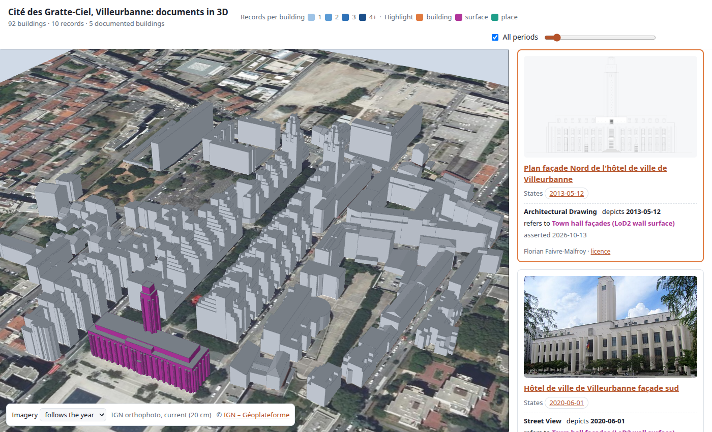
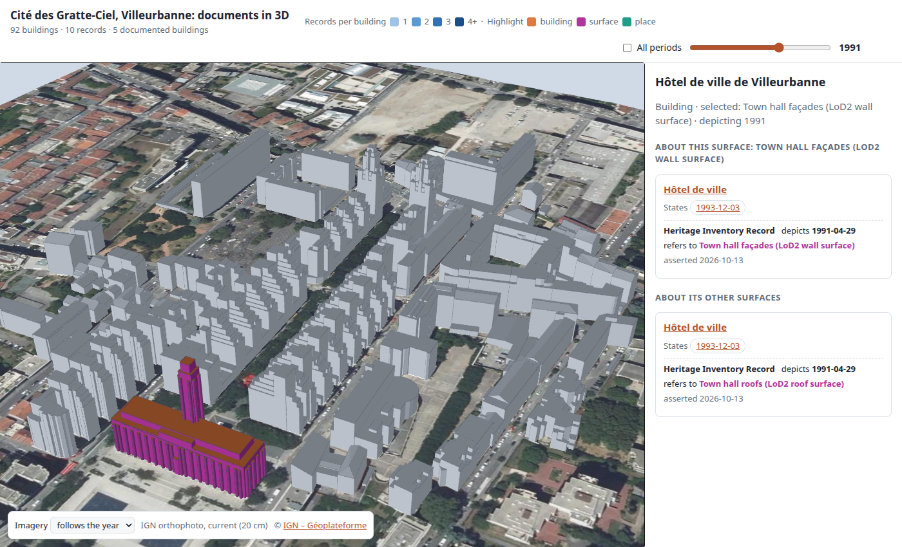
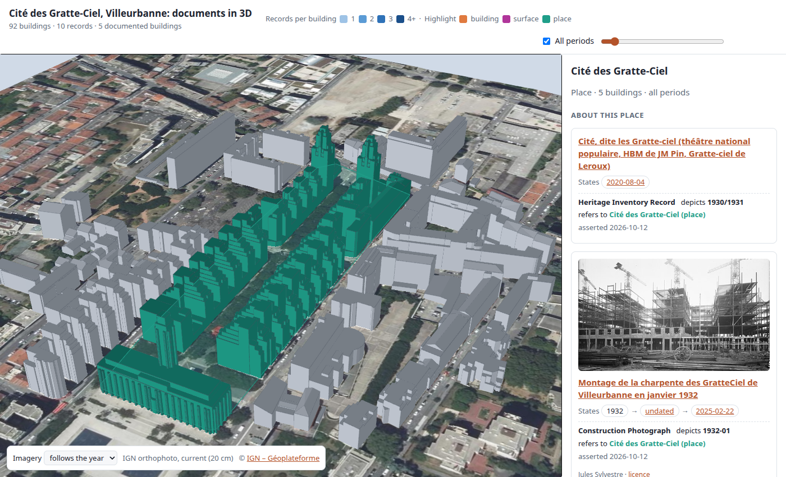
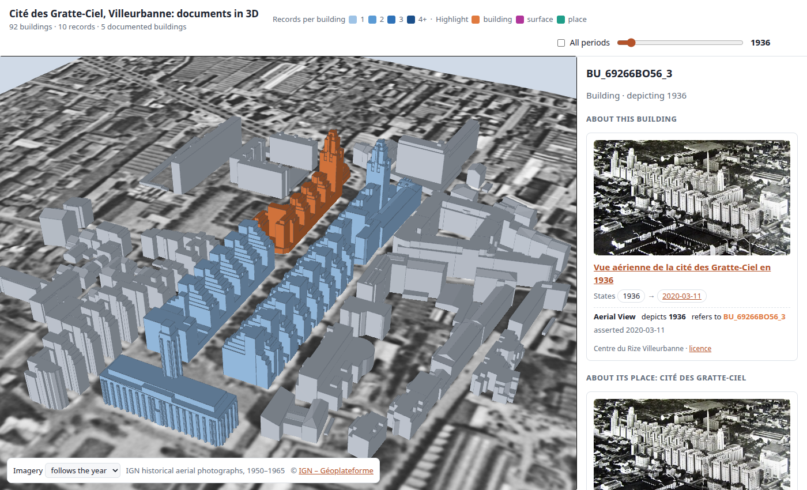

# 3D viewer

A browser view of the Cité des Gratte-Ciel in 3D, in its geographic context, with the documents that refer to it. It is built on [iTowns](https://www.itowns-project.org/) and reads the archival (RiC-O) view produced by the [alignment](../alignment/README.md): records, their states, and their qualified references.

Documents and city objects are linked both ways, at the scale of each reference: a place, a building, or a surface of a building.

| Document → objects | Objects → documents |
|---|---|
|  |  |
| The north façade drawing refers to the town hall's **wall surface**: only that surface is highlighted (magenta). | Clicking the town hall's walls selects that **surface**: the panel lists the records about it, then about its other surfaces, the building and its place. |
|  |  |
| The 1936 aerial view refers to the four Gratte-Ciel blocks as **buildings** (orange) and to the district, which reaches the rest of the **place**: the town hall and the Cité's outline on the ground (green). | Selecting the **place** highlights its five buildings and its outline, and lists the records about the place, then about its buildings. |



## What it shows

* **Space**: an iTowns planar view in EPSG:3946 (RGF93 / CC46), about 900 m across, with IGN's terrain model (RGE ALTI) and aerial imagery from the [Géoplateforme](https://geoservices.ign.fr/). The LoD2 roofs and walls of the 92 buildings within 200 m of the Gratte-Ciel ([`../gratteciel/gratteciel-geometry.ttl`](../gratteciel/gratteciel-geometry.ttl)) stand at their real coordinates and heights on that terrain, each roof and wall surface as its own object. With nothing selected, the documented buildings are coloured by the number of records that refer to them.
* **Objects → documents**: click a roof or a wall to select that surface and its building, or a place button (*Cité des Gratte-Ciel*) in the overview to select the place. The panel lists the records about the selection, grouped by scale: *about this surface*, *about this building*, *about its other surfaces*, *about its place* (or, for a place, *about this place* and *about its buildings*). Each record shows an image when the source has one, its chain of states (original → digital library → Wikimedia Commons, each linked to its source), and each reference's purpose, depicted period, certainty when recorded, assertion date and target. Click elsewhere to come back to the overview.
* **Documents → objects**: click a record (anywhere but its links) to highlight what it refers to, at the scale of each reference: the surfaces it targets (magenta), the buildings it targets (orange), and for references to a place, the place's buildings and its outline on the ground (green). Click it again to stop. Keyboard: Tab to a record, Enter.
* **Time**: untick *All periods* and move the slider to keep only the references whose depicted period contains that year (for example 1932 for the construction photograph, 1936 for the aerial view, 1991 for the listing of the town hall). The imagery follows the year: up to 1965 it shows IGN's historical aerial photographs of 1950–1965, the closest available to the period of the Gratte-Ciel, afterwards the current 20 cm orthophoto. The *Imagery* menu fixes one or the other.
* **Shareable views**: the address keeps the view, e.g. `#building=BU_69266BO55_0&surface=WallSurface_60&year=1991`, `#record=document_6_record`, `#place=place_gratteCiel`. Parameters: `place`, or `building` and `surface`; `record`; `year`; `imagery` (`current` or `historical`).

Navigation (iTowns planar controls): drag to pan, wheel to zoom, Ctrl + drag to rotate.

## Run it

The page uses ES modules, so it must be served over HTTP rather than opened as a file:

```bash
cd data/viewer
python3 -m http.server 8000
```

Then open <http://localhost:8000>. The browser needs WebGL and network access: iTowns 2.46.0 and three.js 0.174.0 load from jsDelivr, the imagery and terrain from IGN's WMS (`data.geopf.fr`), and document images from Wikimedia Commons. In the browser console, `window.viewer` is the iTowns view; each surface mesh carries its building, surface and current highlight role in `userData`.

## Regenerate the scene

[`scene.js`](scene.js) is generated from the RDF data and committed so the viewer works without Python. After changing the data or the alignment, regenerate it from the repository root:

```bash
.venv/bin/python data/viewer/build_scene.py
```

[`build_scene.py`](build_scene.py) aligns `gratteciel-documents.ttl` and `gratteciel-geometry.ttl` with `materialize.py`, then queries the RiC-O view (`rico:Record`, `rico:Instantiation`, `rico:Relation` with its two `rico:DateType`s and its certainty) and the CityOWL geometry. It writes:

* each building with its surfaces (IRI, roof or wall, label, polygons in metres relative to an origin: EPSG:3946 x/y and the source heights, rounded to the centimetre);
* each place with the buildings located in it (`rico:hasOrHadLocation`) and an outline, the convex hull of their footprints;
* each record with its states and references; each reference with its scale (`building`, `surface` or `place`), its target, the place it reaches, and the buildings it reaches.

## Test

[`test/browser_check.py`](test/browser_check.py) serves this folder on a local port and drives the page in headless Chromium with software WebGL. It checks:

* every LoD2 polygon triangulates, with the triangle area matching the polygon area;
* the year filter and the imagery switch;
* objects → documents: a real mouse click on the town hall's roof selects its roof surface, and the panel lists the record about it;
* documents → objects: the façade drawing highlights only the town hall's wall surface; the 1936 aerial view highlights the four blocks as buildings and, through its district reference, the town hall and the place outline; the Cité's heritage record highlights the place's five buildings and its outline;
* selecting the place highlights its buildings and outline;
* no page error.

[`test/screenshots.py`](test/screenshots.py) regenerates the screenshots above from their shareable views.

```bash
cd data/viewer/test
pip install playwright && python -m playwright install chromium
python browser_check.py
python screenshots.py
```

HTTP errors from IGN's WMS are reported separately: under load its historical layer sometimes rejects requests, which is not a failure of the viewer.

## Files

| File | Content |
|---|---|
| [`index.html`](index.html) | Page layout, light and dark themes, legend, time filter, imagery menu |
| [`viewer.js`](viewer.js) | iTowns view, IGN layers, surface meshes (polygon triangulation), place outlines, selection and highlighting, document panel |
| [`build_scene.py`](build_scene.py) | Builds `scene.js` from the RDF data |
| [`scene.js`](scene.js) | Generated scene data |
| `screenshot*.png` | The screenshots above |
| [`test/`](test/) | Browser test and screenshot script (Python, Playwright) |

## Limitations

* No IGN imagery covers the 1930s: the historical layer starts in 1950. For 1932 and 1936 the base map is therefore some 15–30 years later than the documents.
* IGN's WMS occasionally rejects requests for the historical layer under load (HTTP 400); iTowns then keeps a coarser tile, so parts of the historical imagery can look softer.
* A surface is the LoD2 wall or roof surface of a building as a whole: the model does not split walls into individual façades, so a reference to the north façade highlights all the town hall's walls.
* The place outline is the convex hull of its buildings' footprints, an approximation of the place's extent; the sources give no boundary.
* Dates known only to a year or a month are stored as the first day of that period, so the viewer shows them as a year (the January 1932 photograph's original appears as "1932").
* Documents 2–4 refer to the district, because their sources do not say which building they show.
* The undocumented buildings around the Gratte-Ciel are shown for context only.
